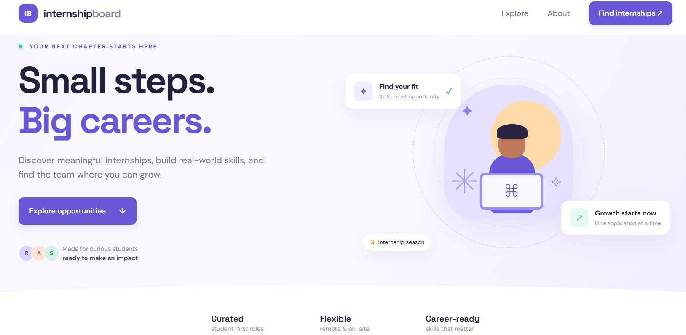
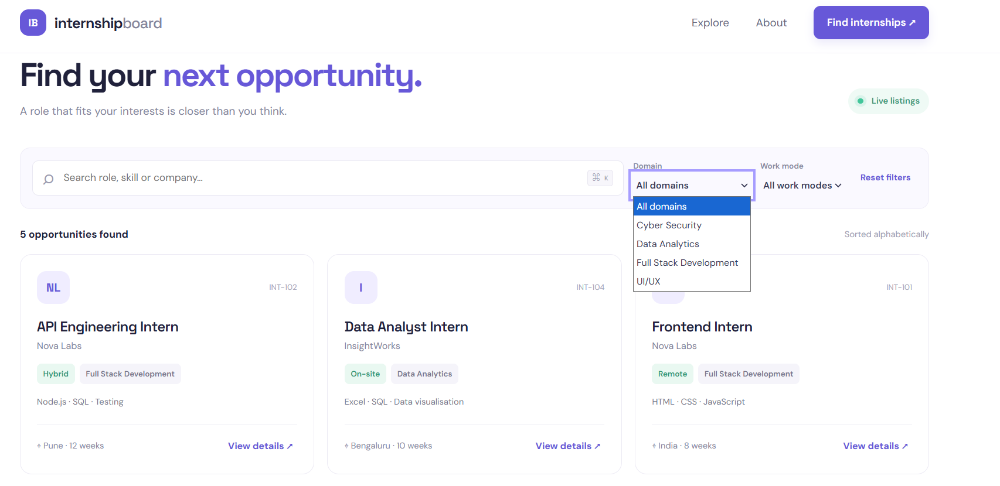

<h1 align="center">🎓 Internship Board</h1>

<div align="center">

### Discover opportunities. Explore internships. Apply with confidence.

A responsive full-stack internship portal where students can explore internship listings, filter opportunities, view details, and submit applications through a validated application form.

<p>
  
  
  
  
  
</p>

</div>

---

## 📌 Overview

**Internship Board** is a full-stack web application designed to simplify internship discovery and application.

It provides a responsive interface backed by a REST API and SQLite database.

Students can browse available internship opportunities, search and filter listings, view detailed information, and submit applications through a validated application form.

The application uses sample internship records for demonstration purposes.

## ✨ Features

- **Browse Internships:** Explore internship opportunities through structured listing cards.
- **Search Opportunities:** Search by internship title, domain, or skills.
- **Filter Listings:** Filter internships by domain and work mode.
- **View Details:** View complete internship information in a dedicated dialog.
- **Submit Applications:** Apply for internships using an application form.
- **Form Validation:** Client-side and server-side validation of application data.
- **Email Typo Detection:** Detect configured common email domain mistakes.
- **Duplicate Prevention:** Prevent repeated applications for the same internship and email.
- **Responsive Design:** Optimized interface for desktop, tablet, and mobile devices.
- **Accessible Interactions:** Keyboard-friendly controls and accessible form feedback.
- **User Feedback:** Loading, empty, error, and retry states.
- **Pagination:** Load additional internship listings when available.
- **Request Logging:** Structured JSON logs for HTTP requests and server events.
- **Database Monitoring:** Health-check endpoint to verify database connectivity.

## 🧰 Tech Stack

| Layer | Technologies |
|---|---|
| Frontend | HTML5, CSS3, Vanilla JavaScript |
| Backend | Node.js, Express.js |
| Database | SQLite |
| API | REST API |
| Security | Helmet, express-rate-limit, parameterized SQL queries |
| Testing | Node.js built-in test runner |
| Development Tools | npm, Git, GitHub |

## 🖥️ Application Screenshots

### Homepage



### Internship Filters



### Internship Details


### Application Form


## 🚀 Getting Started

Follow these instructions to run the application locally.

### Prerequisites

Make sure the following tools are installed:

- Node.js 22 or later
- npm (included with Node.js)
- Git (optional, for cloning the repository)

### 1. Clone the Repository

```bash
git clone https://github.com/rahuls0703/internship-secure-integration.git

cd internship-secure-integration
```

### 2. Install Dependencies

```bash
npm install
```

### 3. Seed the Internship Data

```bash
npm run seed
```

This initializes the database with sample internship records.

### 4. Start the Application

For normal execution:

```bash
npm start
```

For development with automatic server restarting:

```bash
npm run dev
```

### 5. Open the Application

Visit the following address in your browser:

```text
http://localhost:3000
```

The Express server serves the frontend and backend API from the same application.

## 🗂️ Project Structure

```text
internship-board/
│
├── frontend/
│   ├── index.html
│   ├── css/
│   │   └── style.css
│   └── js/
│       ├── app.js
│       ├── api.js
│       └── validation.js
│
├── backend/
│   ├── data/
│   │   └── internships.json
│   ├── src/
│   │   ├── database/
│   │   │   ├── db.js
│   │   │   └── seed.js
│   │   ├── routes/
│   │   │   ├── internships.js
│   │   │   └── applications.js
│   │   └── server.js
│   └── tests/
│       └── api.test.js
│
├── docs/
│   ├── images/
│   ├── ACCESSIBILITY.md
│   ├── API.md
│   └── DATABASE.md
│
├── .env.example
├── .gitignore
├── package.json
├── package-lock.json
└── README.md
```

## 🔌 API Documentation

The backend provides REST endpoints for retrieving internship listings, viewing individual internships, submitting applications, and monitoring application health.

| Method | Endpoint | Description |
|---|---|---|
| GET | `/api/internships` | Retrieve internship listings |
| GET | `/api/internships/:id` | Retrieve a specific internship |
| POST | `/api/applications` | Submit an internship application |
| GET | `/api/health` | Check application and database health |

### Health Check

The `/api/health` endpoint executes a database query to verify SQLite connectivity.

**Example successful response:**

```json
{
  "status": "success",
  "data": {
    "ok": true,
    "database": "connected"
  },
  "pagination": null
}
```

The endpoint returns HTTP `503 Service Unavailable` if the database health check fails.

For request parameters, payload examples, and response formats, refer to the [API Documentation](docs/API.md).

## 🔐 Security Implementation

The application incorporates multiple security measures to protect API endpoints and application data.

- **Helmet:** Configures secure HTTP headers.
- **Rate Limiting:** Restricts application submission attempts to 10 requests per 15 minutes.
- **Parameterized SQL Queries:** Uses prepared statements to protect database operations against SQL injection.
- **Server-side Validation:** Validates application data before processing submissions.
- **Client-side Validation:** Provides immediate feedback for invalid form inputs.
- **Email Domain Typo Detection:** Identifies configured common email domain mistakes.
- **Duplicate Application Prevention:** Prevents repeated applications for the same internship and email.
- **Request Size Limits:** Restricts incoming JSON and URL-encoded request payloads to 20 KB.
- **Sensitive Data Protection:** Excludes applicant information and request bodies from HTTP request logs.

## 📊 Logging and Monitoring

The application implements structured JSON-based server logging to support monitoring and troubleshooting.

Request logs capture:

- HTTP request method.
- Request path.
- Response status code.
- Request processing duration.
- Timestamp.
- Log severity.

**Example request log:**

```json
{
  "level": "info",
  "event": "http_request",
  "method": "GET",
  "path": "/api/internships",
  "statusCode": 200,
  "durationMs": 3.45,
  "timestamp": "2026-11-21T10:00:00.000Z"
}
```

Server errors are logged separately with error-level severity.

Applicant names, email addresses, and request bodies are not included in HTTP request logs.

The application also includes a database health-check endpoint to verify database connectivity.

## 🧪 Automated Testing

The project uses Node.js's built-in test runner to verify API functionality.

The automated API test covers:

- Internship listing.
- Internship filtering.
- Internship detail retrieval.
- Application validation.

Run the test suite using:

```bash
npm test
```

**Latest verified test result:**

```text
✔ API listing, filters, detail and application validation

ℹ tests 1
ℹ pass 1
ℹ fail 0
ℹ cancelled 0
ℹ skipped 0
```

## 🗄️ Database

The application uses SQLite to manage internship and application data.

The database initialization and sample internship records are handled through the seed script.

For database setup and schema information, refer to the [Database Documentation](docs/DATABASE.md).

## ♿ Accessibility

The application includes accessibility improvements to make interactions easier for users.

These include:

- Keyboard-friendly navigation.
- Accessible form validation feedback.
- Appropriate ARIA attributes.
- Keyboard controls for interactive dialogs.

For additional details, refer to the [Accessibility Documentation](docs/ACCESSIBILITY.md).

## 🛣️ Future Enhancements

Potential improvements for future versions include:

- Internship bookmarking and saved listings.
- Applicant dashboard with application status tracking.
- Authentication for students and recruiters.
- Recruiter tools to create and manage internship postings.
- Email notifications for application updates.
- Production deployment with a managed database and environment-specific configuration.

## 👨‍💻 Author

**Rahul S**

B.E. Computer Science and Engineering  
Chennai Institute of Technology

- **GitHub:** [@rahuls0703](https://github.com/rahuls0703)
- **Project Repository:** [Internship Board – Secure Integration](https://github.com/rahuls0703/internship-secure-integration)

## 🤝 Acknowledgements

This project was developed as part of a full-stack web development internship task.

The internship listing dataset contains sample/fictional records for demonstration purposes.

---

<div align="center">

**Built with ❤️ using HTML, CSS, JavaScript, Node.js, Express, and SQLite.**

</div>