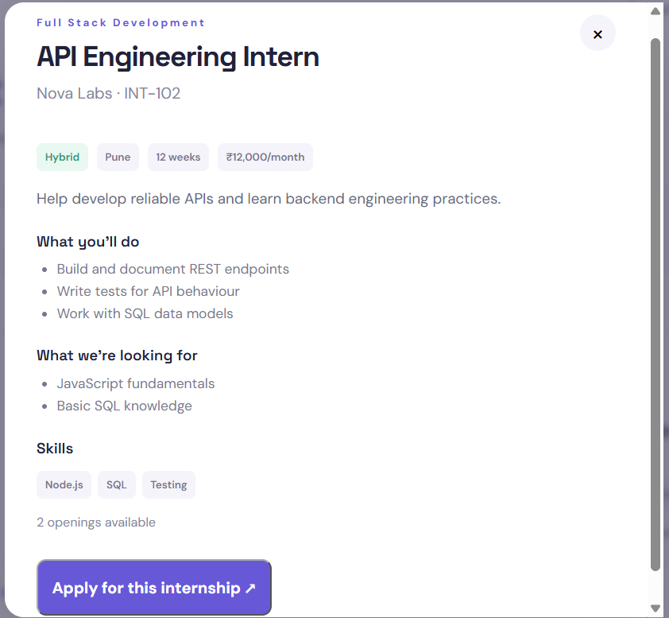
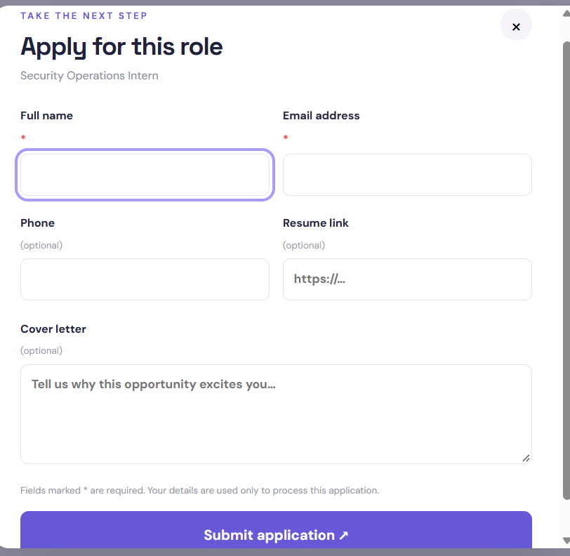

\<div align="center">

# 🎓 Internship Board

### Discover opportunities. Explore internships. Apply with confidence.

A responsive full-stack internship portal where students can explore internship listings, filter opportunities, view details, and submit applications through a validated application form.


\


\</div>

---

## 📌 Overview

**Internship Board** is a full-stack web application designed to make internship discovery and application easier.

It provides a clean, responsive interface backed by a REST API and SQLite database.

The application includes sample internship records and supports searching, filtering, viewing internship information, and applying to opportunities.

## ✨ Features

- **Browse internships** with structured listing cards.
- **Search opportunities** by title, domain, or skills.
- **Filter listings** by internship domain and work mode.
- **View internship details** in a dedicated dialog.
- **Submit applications** with applicant and internship information.
- **Client-side and server-side validation** for application data.
- **Email typo detection** for common domain mistakes.
- **Duplicate application prevention** for the same internship and email.
- **Responsive interface** for desktop, tablet, and mobile.
- **Accessible interactions** with keyboard-friendly controls.
- **Loading, empty, error, and retry states** for a better user experience.
- **Structured request logging** for monitoring HTTP requests, response status codes, and request processing time.
- **Database health monitoring** through a dedicated health-check endpoint.

## 🧰 Tech Stack

| Layer       | Technologies                                          |
| ----------- | ----------------------------------------------------- |
| Frontend    | HTML5, CSS3, Vanilla JavaScript                       |
| Backend     | Node.js, Express.js                                   |
| Database    | SQLite                                                |
| API         | REST                                                  |
| Security    | Helmet, express-rate-limit, parameterized SQL queries |
| Testing     | Node.js built-in test runner                          |
| Development | npm, Git, GitHub                                      |

## 🖥️ Application Screenshots

### Homepage


### Internship Filters


### Internship Details


### Application Form


## 🚀 Getting Started

### Prerequisites

- Node.js 22 or later
- npm (included with Node.js)
- Git (optional, for cloning)

### 1. Clone the repository

```bash
git clone https://github.com/rahuls0703/internship-secure-integration.git

cd internship-secure-integration
```

### 2. Install dependencies

```bash
npm install
```

### 3. Seed the internship data

```bash
npm run seed
```

### 4. Start the application

For normal execution:

```bash
npm start
```

For development with automatic server restarting:

```bash
npm run dev
```

### 5. Open in your browser

Visit:

```text
http://localhost:3000
```

The Express server serves the frontend and API from the same application.

## 🗂️ Project Structure

```text
internship-board/
├── frontend/
│   ├── index.html
│   ├── css/
│   │   └── style.css
│   └── js/
│       ├── app.js
│       ├── api.js
│       └── validation.js
├── backend/
│   ├── data/
│   │   └── internships.json
│   ├── src/
│   │   ├── database/
│   │   │   ├── db.js
│   │   │   └── seed.js
│   │   ├── routes/
│   │   │   ├── internships.js
│   │   │   └── applications.js
│   │   └── server.js
│   └── tests/
│       └── api.test.js
├── docs/
│   ├── images/
│   ├── ACCESSIBILITY.md
│   ├── API.md
│   └── DATABASE.md
├── .env.example
├── .gitignore
├── package.json
├── package-lock.json
└── README.md
```

## 🔌 API Documentation

The backend exposes REST endpoints for internship listings, applications, and application health monitoring.

| Method | Endpoint               | Purpose                               |
| ------ | ---------------------- | ------------------------------------- |
| GET    | `/api/internships`     | Retrieve internship listings          |
| GET    | `/api/internships/:id` | Retrieve a specific internship        |
| POST   | `/api/applications`    | Submit an internship application      |
| GET    | `/api/health`          | Check application and database health |

### Health Check

The `/api/health` endpoint executes a database query to verify SQLite connectivity.

Example successful response:

```json
{
  "status": "success",
  "data": {
    "ok": true,
    "database": "connected"
  },
  "pagination": null
}
```

The endpoint returns HTTP `503` if the database health check fails.

For request parameters, payload examples, and response formats, see [API Documentation](docs/API.md).

## 🔐 Security Implementation

The application implements multiple security measures to protect API endpoints and application data.

- **Helmet:** Configures secure HTTP headers to improve application security.
- **Rate Limiting:** Restricts application submission attempts to 10 requests per 15 minutes.
- **Parameterized SQL Queries:** Uses prepared statements to protect database operations against SQL injection.
- **Server-side Validation:** Validates application data before processing submissions.
- **Client-side Validation:** Provides immediate feedback for invalid form inputs.
- **Email Domain Typo Detection:** Identifies configured common email domain mistakes.
- **Duplicate Application Prevention:** Prevents repeated applications for the same internship and email.
- **Request Size Limits:** Restricts incoming JSON and URL-encoded request payloads to 20 KB.
- **Sensitive Data Protection:** Request logs exclude applicant information and request bodies.

## 📊 Logging and Monitoring

The application includes structured JSON-based server logging.

Request logs capture:

- HTTP request method.
- Request path.
- Response status code.
- Request processing duration.
- Timestamp.
- Log severity.

Example log entry:

```json
{
  "level": "info",
  "event": "http_request",
  "method": "GET",
  "path": "/api/internships",
  "statusCode": 200,
  "durationMs": 3.45,
  "timestamp": "2026-11-21T10:00:00.000Z"
}
```

Server errors are logged separately with error-level severity.

Applicant names, email addresses, and request bodies are not included in request logs.

## 🧪 Automated Testing

The project uses Node.js's built-in test runner.

The existing automated API test covers:

- Internship listing.
- Internship filtering.
- Internship detail retrieval.
- Application validation.

Run the test suite using:

```bash
npm test
```

## 🗄️ Database

Internship and application data are managed using SQLite.

The seed script initializes the sample internship records.

For database setup and schema details, see [Database Documentation](docs/DATABASE.md).

## ♿ Accessibility

The interface includes keyboard-friendly interactions and accessible UI behavior.

See [Accessibility Documentation](docs/ACCESSIBILITY.md).

## 🛣️ Future Enhancements

- Internship bookmarking and saved listings.
- Applicant dashboard with application status.
- Authentication for students and recruiters.
- Recruiter tools to create and manage internship postings.
- Email notifications for application updates.
- Deployment with a managed database and production environment configuration.

## 👨‍💻 Author

**Rahul S**

B.E. Computer Science and Engineering
Chennai Institute of Technology

- GitHub: [@rahuls0703](https://github.com/rahuls0703)
- Project Repository: [internship-secure-integration](https://github.com/rahuls0703/internship-secure-integration)

## 🤝 Acknowledgements

This project was developed as part of a full-stack web development internship task.

The internship listing dataset contains sample/fictional records for demonstration purposes.

---

\<div align="center">

**Built with ❤️ using HTML, CSS, JavaScript, Node.js, Express, and SQLite**

\</div>
